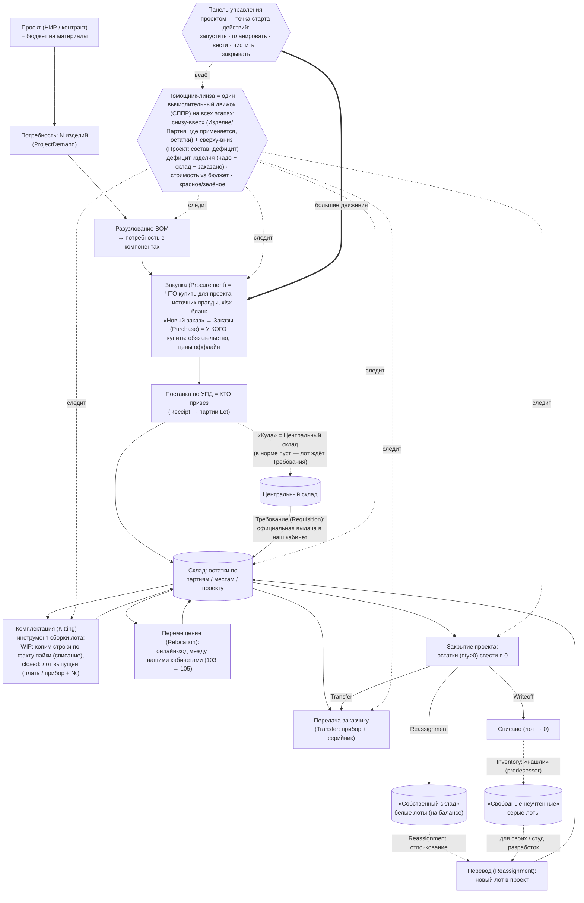

# Plume

Веб-приложение для управления жизненным циклом изделий (PLM) — для небольших
студенческих и научных команд, которые ведут НИР и мелкосерийное производство.

Идея: проект ограничен во времени (НИР на разработку изделия или контракт на
выпуск конкретного количества). PLM избавляет от ручного заполнения актов
комплектации и даёт ответ на вопросы: **сколько каких компонентов осталось, по
какому проекту они куплены, хватает ли их на сборку изделия и что делать с
остатками при закрытии проекта.**

## Возможности (MVP)

- Единый справочник номенклатуры (изделия и компоненты) и состав изделия (BOM).
- Закупки и поставки по УПД, склад с учётом партий и мест хранения (реестр движений).
- Закупка под заданное количество изделий: разузлование состава (BOM), расчёт
  дефицита (надо − склад − заказано) и экспорт xlsx-бланка для поставщиков.
- Акты комплектации образцов (автоматическое списание по BOM).
- Проекты со сквозным потоком: закупки → комплектация → передача → сверка
  балансов и решение по остаткам.

## Стек

Django + Django REST Framework · React + TypeScript (Vite) · MySQL/MariaDB.
Рассчитано на shared-хостинг (напр. reg.ru): без Celery/Redis, тяжёлые операции
синхронно, периодика через cron.

## Быстрый старт

Нужны **Python 3.14** (pyenv), **Node 22 LTS** (nvm) и Docker — локальный рантайм
намеренно повторяет прод (reg.ru shared), чтобы «локально ≠ на сервере» не всплывало
на выкате.

```bash
# 1. БД: MySQL 8.0.25 в Docker, порт хоста 3307 (на Apple Silicon — amd64 под Rosetta)
cd backend && docker compose up -d

# 2. Бэкенд: venv на Python 3.14
cd backend
python3.14 -m venv .venv && .venv/bin/pip install -r requirements.txt
cp .env.example .env                 # .env не трекается — секреты в репо не кладём
.venv/bin/python manage.py migrate
.venv/bin/python manage.py createsuperuser
.venv/bin/python manage.py runserver # http://127.0.0.1:8000 (API + админка)

# 3. Фронтенд
cd frontend && npm install && npm run dev   # http://localhost:5173
```

Открывать **`http://localhost:5173`**: Vite отдаёт SPA и проксирует `/api` и `/admin`
на Django. Демо-данные — `manage.py seed_demo`.

Проверки (их же гоняет предполётная `deploy/preflight.sh`):

```bash
cd backend && .venv/bin/python manage.py test plume   # сюита бэкенда
cd frontend && npx tsc --noEmit && npm run build && npm run lint
```

**Выкат на прод** — только через `deploy/deploy_local.sh` (секреты передаются
аргументами, не хранятся в репозитории); рантбук и порядок действий —
в [deploy/README.md](deploy/README.md).

## Словарь терминов

В коде, базе данных и на технической диаграмме сущности названы по-английски (так
короче и привычнее для разработки). Здесь — их русские эквиваленты и смысл. Это
единый язык проекта: на нём говорим в обсуждениях и в интерфейсе.

**Единый интерфейс идентичности (канон, волна 19, Ф10).** У КАЖДОЙ сущности ровно
пара `code` + `description`: `code` — уникальный короткий ключ-жаргон (напр. Item
`BGB707…`, проект `ДО`, закупка `Нева ДЗЗ 1`; вводится человеком, авто-фолбэка нет →
у новоприобретающих поле — `nullable+unique`), `description` — развёрнутое человеческое
имя. Расползшиеся синонимы (`name`/`label`/`note`) сведены к этой паре; документы несут
её сверх своих юридических полей (`number`/`date`/`contractor`). Списки, пикеры и шапки
форм везде показывают одну пару. Исключений **не осталось**: `Item.design_item_id`
переехал в `code` последним (Ф3b, 2026-07-25) — значение то же (заказной PN, канон
библиотеки Altium), имя общее. Вложение подтянулось следом (Ф12a, 2026-07-26:
`Attachment.label` → `description`): своего `code` у файла нет, его идентичность —
`filename`, и описание идёт сразу за ним.

### Сущности

| English (БД/код) | Русский | Значение и связи |
|---|---|---|
| `Item` | Изделие | Единица справочника, **абстракция** (для прибора — конструкторская документация, для покупного — datasheet). Едина для приборов, компонентов и материалов. Ключ `code` — заказной PN (канон внешней библиотеки Altium, колонка CSV «Design Item Id»; бывш. поле `design_item_id`, Ф3b); класс — справочник `Category` (FK). **Три ортогональных бул-оси** (Ф3a): `native` (наше производимое / внешнее покупное — делит на режимы «Изделия»/«Компоненты»), `synced` (из библиотеки Altium / заведено вручную — ставит синк, руками не снять; у библиотечного правится только цена), `locked` (замок-фиксация). Инвариант `synced ⟹ not native`. «Используется/спящий» — **вычисляемо** (Exists по живым ссылкам; хранимого `active` нет). Может состоять из изделий (рекурсивный состав через `BomLine`). |
| `Category` | Категория | Смысловой класс позиции справочника, **разделённый по оси `native`** (2026-10-15) — та же ось, что у `Item`: категории изделий (Система / Прибор / Узел печатный / Кабельная сеть / КПА / Оснастка / Расходный материал / Другое) и категории компонентов (Электронный компонент / Механический компонент / Печатная плата / Деталь / Материал / Крепёж / Инструмент / Расходный материал / Другое). Изделие берёт только категорию своей стороны (гейт в движке + `Item.clean`; при смене оси чужая сбрасывается). Всё синкаемое из библиотеки Altium — одна категория «Электронный компонент» (класс по имени CSV-файла упразднён). `code` — короткий жаргон (`ЭК`, `ПРБ`…), в интерфейсе показывается `description`. FK-справочник вместо прежнего enum `Item.kind`. |
| `BomLine` | Строка состава | Одна позиция состава изделия: «изделие-родитель → компонент × количество». |
| `Lot` | Партия | Главная учётная единица склада — **физическое воплощение** изделия. Хранит **стоимость** (`cost` — сумма строки УПД / себестоимость сборки; цена штуки только вычисляется) и идентичность — пару `code` (PN с коробки; **единственный неуникальный код в схеме** — два УПД одной катушки = два лота с одним PN) + `description` (наименование из УПД). Оба — факты, вводятся один раз в origin-ордере (волна 27). Рождается ровно одним документом-источником, живёт в одном проекте. Своя форма (только чтение) и режим «Склад». |
| `StockLine` | Строка движения | Единая знаковая строка расхода/перемещения существующей партии `(документ, лот, место, ±кол-во)`. Свернула четыре таблицы строк-расхода (комплектация/передача/списание/перевод) в одну (волна 13, Ф0); владелец — один FK `document → StockDocument` (дуга схлопнута в Ф2b; вид = `document.kind`). Рождение лотов сюда не входит (born-direct через `Lot.origin`). |
| `StockMovement` | Движение склада | Строка реестра движений: ±количество и ±стоимость по партии и месту. Проекция: пересчитывается из документов (born-лоты + `StockLine`), остаток = сумма движений (и в штуках, и в рублях). |
| `Location` | Локация (место хранения) | Где физически лежит партия. Мультисклад (волна 13, Ф2e): остаток считается по паре `(лот, локация)`. Волна 27: ровно одна локация — **Центральный склад** (`central`, синглтон в БД): сюда приходят поставки (УПД оформляет бухгалтерия), отсюда партии уходят **Требованием**; в норме он пуст. Остальные — наши кабинеты, между ними ходит **Перемещение**. Режим «Локации». |
| `Project` | Проект | НИР или контракт, ограниченный во времени; сквозное измерение всего. Бывает внешним и внутренним (`kind`: «Собственный склад» / «Свободные неучтённые»). |
| `ProjectDemand` | Потребность проекта | Сколько изделий нужно выпустить. Вход разузлования состава. |
| `Procurement` | Закупка | **ЧТО купить** — планирование: что и сколько решили взять (экспертная оценка). Один поток общения = один xlsx-бланк. **Охват** — под какие проекты ведётся — **вычисляемый**: это проекты её заказов (2026-08-05; до того M2M `projects`, галочки в шапке — второй источник правды на то же отношение, молча расходившийся с заказами). Контрагент (`contractor`, nullable) — **намерение**: у кого собираемся купить; при подсчёте компонентов до него могло и не дойти. Нарезается в Заказы. |
| `Purchase` | Заказ | **У КОГО купить** — проектное исполнение: документально зафиксированное обязательство в рамках одного проекта. Несёт своего контрагента (`contractor`, волна 19, Ф17): обязателен к фиксации, а не к рождению. Закупка-план (`procurement`) **опциональна** — заказ бывает и без плана. Разрешается в поставки. |
| `Receipt` | Поставка (УПД) | **КТО привёз** — приёмка по универсальному передаточному документу; рождает партии. Несёт контрагента-поставщика (`contractor`) и дату. (Прежнее имя термина — «Приход»; код/UI на «Поставку» с волны 14.) |
| `Counterparty` | Контрагент | Единая внешняя сторона документооборота: поставщик закупки/заказа/поставки и/или заказчик передачи — **направление читается из вида документа**, а не из свойства справочника. Свернул прежний `Supplier` (волна 13, Ф2f+). **Ролей-флагов нет** (волна 20, Ф3: `is_supplier`/`is_customer` снесены): «сторона» контрагента — не декларация, а факт документооборота, движок выводит её из его же закупок/заказов/поставок и передач (`counterparty_sides`); пикеры не фильтруют по роли (это прятало нужную запись), а поднимают «своих» наверх. **Наша организация — тоже обычный контрагент** (волна 19, Ф4b): правится той же формой, несёт те же реквизиты и карточку предприятия; окружение знает лишь её id (`ORG_COUNTERPARTY_ID`) — этим xlsx-бланк закупки подписывается нашей стороной, а название организации не попадает в репозиторий. Отсюда же бесплатно выходит закупка «у себя». |
| `Kitting` | Комплектация | Сборка изделия: списание компонентов (по факту пайки) и рождение партии-прибора при закрытии. Главная работа системы. |
| `Transfer` | Передача | Отгрузка готового железа заказчику по накладной (по партиям). Несёт структурного контрагента-заказчика (`contractor`, nullable; волна 13, Ф2f+). |
| `Inventory` | Инвентаризация | Рождает «найденные» партии (излишки, возврат в учёт). |
| `Writeoff` | Списание | Вывод партии из учёта с указанием причины. |
| `Requisition` | Требование | Волна 27: **официальная выдача с Центрального склада на нашу локацию** (документ бухгалтерии; вписывается в акт комплектации — акт находит его по своим лотам). Один проект; «Куда» — в шапке. Механика перемещения: пара `−q`@Центральный / `+q`@«Куда». |
| `Reassignment` | Перевод | **Отпочкование** (до волны 27 — «Требование»): часть партии уходит в другой проект новым лотом-потомком (обычно из «Собственного склада»). Проект меняет, место нет — потомок рождается там, где лежал источник. |
| `Relocation` | Перемещение | Онлайн-ход партии между **нашими** локациями внутри проекта (волна 13, Ф2e; юридической силы нет). Центральный не трогает (волна 27). Не рождает и не выбывает лот: пара знаковых `StockLine` (`−q` источник / `+q` приёмник), тотал лота сохранён. В отличие от `Transfer` (терминальна, заказчику) остаётся в учёте. |
| `Attachment` | Вложение | Файл на диске: скан документа, datasheet/чертёж изделия, бумаги проекта/закупки/заказа или карточка контрагента (волна 19, Ф12b — владелец ровно один из шести). |
| `User` | Пользователь | Сотрудник-автор документов; **внешняя сущность** (`django.contrib.auth`) — ДНК Django приложение не подменяет. Идентичность человека — `username` (титул его формы, полем не правится: логин задаётся в админке); литературное имя — `first_name`+`last_name`, оно и стоит в подписях авторства. Со волны 21 у пользователя есть **своя форма** («Аккаунт»): имя/фамилия/почта, выбор темы, смена пароля, выход и три таба своих документов. Оси фиксации у него нет — он не документ, замораживать нечего (только личный замок формы). Деактивируем (`is_active`), не удаляем. |
| `UserProfile` | Профиль пользователя | Настройки и контакты человека **приставкой** к `User` (1:1, CASCADE), а не кастомной моделью пользователя (волна 21). Рождается лениво, при первом обращении. Поля: `theme` (слаг темы: `dark` / `light`; движок хранит и стережёт слаг, а ярлыки, палитры и CSS ему неизвестны вовсе — [шов «движок ↔ вью»](docs/UI_GUIDE.md#10-цвет-и-тема)) и `phone` (2026-08-10 — контакт автора в бланке, уходящем поставщику; хранится ровно в том виде, в каком показывается, нормализует `engine.normalize_phone` на вводе). |

### Сквозные понятия

| English / жаргон | Русский | Значение |
|---|---|---|
| BOM | Состав изделия | Иерархия «изделие → компоненты» (таблица `BomLine`). |
| origin | Документ-источник | Ордер, родивший партию (Поставка / Комплектация / Инвентаризация / Перевод) — один FK `Lot.origin → StockDocument` (вид = `origin.kind`; дуга схлопнута в Ф2b). |
| predecessor | Партия-предшественник | Ссылка на исходную партию при закрытии или переводе — несёт генеалогию. |
| «Куда» | Локация шапки ордера | `StockDocument.location` (волна 27): куда ордер кладёт партии — рождённые (поставка: по умолчанию Центральный; комплектация, инвентаризация: только наша) или выданные (требование). Обязательна к фиксации. |
| выбор лота = выбор места | Пикер строк расхода | Волна 27: пикеры комплектации, передачи, списания и перевода отдают пары «лот @ локация»; строка хранит место пары. Важен факт списания, кабинет вторичен. |
| ledger | Реестр движений | Таблица `StockMovement` как пересчитываемая проекция остатков. |
| BOM explosion | Разузлование | Рекурсивный обход состава: потребность в изделии → потребность в компонентах. |
| where-used | Где применяется | Обратный обход: в какие изделия входит компонент. |
| pegging | Разворот источников | Раскрытие строки свода: из каких проектов и приборов сложилось число. |
| roll-up | Свод | Суммирование дефицита по изделиям через проекты (до волны 24 — через **охват** закупки; с волны 24 закупка однопроектная, и свод совпадает с «Потребностью» её проекта). |
| scope | Охват закупки | **Снят в волне 24** (2026-10-16): закупка однопроектная (`Procurement.project`), «Потребность» закупки считает по её проекту. До того — проекты её заказов (`procurement_scope`, вычисляемый с 2026-08-05; ещё раньше — M2M-галочки Ф13). |
| привязка | Распределение плана по заказам | Аккордеон строки плана в табе «Строки» закупки: в какие заказы и сколько ушло. С волны 24 — **только чтение**: количество в заказе правится в форме заказа, заказ рождается кнопкой «Новый заказ» (остатком). До волны 24 — матрица с полями в ячейках (`set_allocation`, 2026-08-05). |
| баланс | Баланс потребности | `(скомплектовано + склад + в заказе) − надо`, со знаком: минус — не хватает, плюс — запас, ноль — впритык. Ни один член не клампится, дефицит — **невязка**. «В заказе» с волны 24 = заказано по зафиксированным заказам + **в плане** (зафиксированные закупки сверх своих зафиксированных заказов): ящик 🟠, пока хоть часть держится только планом, 🟢 — когда всё под обязательством. Одно число в трёх местах: «Потребность» проекта, «Потребность» закупки (по её проекту) и баланс в строках закупки и заказа. |
| три уровня контура | Закупка → Заказ → Поставка | **Закупка = ЧТО купить · Заказ = У КОГО купить · Поставка = КТО привёз** (волна 19, Ф17). С волны 24 **Закупка — источник правды и вход в контур**: однопроектная, заказ рождается только из неё (проект заказа — через закупку), строки заказа ⊆ строки плана. Фиксация закупки = позиции «в плане»; фиксация заказа = обязательство возникло. **Контрагент — только у заказа и поставки** (волна 24): закупка — внутреннее планирование, к контрагенту не относится (одна закупка законно уходит нескольким поставщикам). Поставка наследует контрагента заказа копией при рождении; расхождение «поставка ↔ заказ» — оранжевый глиф-подсказка, **не** запрет фиксации. |
| СППР / линза | Помощник-линза | Система поддержки принятия решений: вычисляемые проекции над документами (что заказать? сколько? успеваем? закрываемся?). |

## Модель данных

> Эти диаграммы — источник правды по модели. Любое изменение схемы БД должно
> сразу отражаться здесь.

**Нотация кардинальности значащая** (выправлено Ф17, 2026-07-30): у обязательной связи
со стороны «одного» стоит `||` (ровно один), у **nullable-FK** — `|o` (нуль или один).
Раньше одиннадцать необязательных связей были нарисованы как `||`, а их необязательность
держалась словом «nullable» в подписи — информация была, но нотация её не несла. Правило
механическое: **каждый FK с `null=True` обязан иметь `|o`**. Порядок полей внутри блоков
тоже значащий — он задаёт порядок полей в форме (канон
[UI_GUIDE §13.4a](docs/UI_GUIDE.md)) и порядок объявлений в `models.py`.

### Продуктовая схема (как это работает)



### Техническая схема (структура БД)

```mermaid
erDiagram
  CATEGORY |o--o{ ITEM : "класс своей стороны native (PROTECT, nullable в черновике)"
  ITEM ||--o{ BOMLINE : "как parent"
  ITEM ||--o{ BOMLINE : "как component"
  ITEM ||--o{ LOT : "партии"
  ITEM ||--o{ PURCHASELINE : ""
  ITEM ||--o{ PROCUREMENTLINE : ""
  ITEM ||--o{ PROJECTDEMAND : "target"
  ITEM |o--o{ STOCKDOCUMENT : "target_item (только kitting)"

  COUNTERPARTY |o--o{ STOCKDOCUMENT : "contractor: поставщик у receipt / заказчик у transfer"
  COUNTERPARTY |o--o{ PURCHASE : "контрагент заказа — У КОГО купили (Ф17)"

  LOCATION ||--o{ STOCKMOVEMENT : ""
  LOCATION ||--o{ STOCKLINE : ""
  LOCATION |o--o{ STOCKDOCUMENT : "«Куда» (receipt/kitting/inventory/requisition; волна 27)"

  USER ||--o{ PROCUREMENT : "автор"
  USER ||--o{ PURCHASE : "автор"
  USER ||--o{ STOCKDOCUMENT : "автор (любой вид)"
  USER ||--o{ ATTACHMENT : "загрузил"
  USER ||--o| USERPROFILE : "настройки интерфейса (CASCADE; рождается лениво — потому `o|`)"

  LOT ||--o{ STOCKMOVEMENT : ""
  LOT ||--o{ STOCKLINE : "расход/движение (знаковая строка)"
  LOT |o--o{ LOT : "predecessor (закрытие/перевод)"

  PROJECT ||--o{ PROJECTDEMAND : ""
  PROJECT ||--o{ LOT : "home (проект лота)"
  PROJECT ||--o{ PROCUREMENT : "проект закупки (волна 24: проект заказа — через неё)"
  PROJECT ||--o{ STOCKDOCUMENT : "проект-якорь (у reassignment — получатель)"

  PROCUREMENT ||--o{ PROCUREMENTLINE : ""
  PROCUREMENT ||--o{ PURCHASE : "заказ рождается из закупки (волна 24: NOT NULL)"
  PURCHASE ||--o{ PURCHASELINE : ""
  PURCHASE |o--o{ STOCKDOCUMENT : "purchase (только receipt)"
  STOCKDOCUMENT ||--o{ LOT : "origin (рождение; receipt/kitting/inventory/reassignment — вид = kind)"
  STOCKDOCUMENT ||--o{ STOCKLINE : "расход/движение (kitting/transfer/writeoff/reassignment; пары ± у relocation/requisition — вид = kind)"

  ITEM |o--o{ ATTACHMENT : "datasheet"
  STOCKDOCUMENT |o--o{ ATTACHMENT : "скан ордера (любой вид)"
  PROJECT |o--o{ ATTACHMENT : "ТЗ, договор"
  PROCUREMENT |o--o{ ATTACHMENT : "бланк запроса, КП"
  PURCHASE |o--o{ ATTACHMENT : "счёт, подтверждение"
  COUNTERPARTY |o--o{ ATTACHMENT : "карточка предприятия"

  CATEGORY {
    int id PK
    string code "короткий жаргон (ЭК, ПРБ, …), uniq"
    string description "рус. название — его и показывает интерфейс"
    bool native "сторона: категория изделий (true) / компонентов (false); у изделия category.native = item.native"
  }
  ITEM {
    int id PK
    string code "заказной PN (канон библиотеки Altium, колонка «Design Item Id»), uniq"
    string description
    bool native "наше производимое (true) / внешнее покупное (false); делит на режимы Изделия/Компоненты"
    bool locked "замок-фиксация: форма read-only, мутации гейтятся"
    bool synced "из библиотеки Altium (true) / заведено вручную (false); ставит синк, руками не снять"
    int category_id FK "→ Category, класс изделия (PROTECT); Ф12e — nullable в черновике, обязательна к фиксации (CHECK item_locked_has_category)"
    string uom "ед. изм."
    string temperature "предельная T компонента (напр. -40-125°C)"
    decimal estimated_cost "оценочная стоимость / роллап по BOM (nullable)"
  }
  %% инвариант: synced ⟹ not native (CheckConstraint). Матрица synced×locked:
  %%   ручной+расфикс → правь всё; библ.+расфикс → только цена; зафикс → read-only.
  BOMLINE {
    int id PK
    int parent_id FK
    int component_id FK
    decimal qty
  }
  COUNTERPARTY {
    int id PK
    string code "наш ярлык (напр. КОМПЭЛ), uniq, nullable (Ф10)"
    string description "наименование (Ф10: name→description)"
    string inn
  }
  %% Ролей-флагов нет (волна 20, Ф3): сторона — факт документооборота (есть закупки/
  %% заказы/поставки → поставщик, есть передачи → заказчик), а не колонка справочника.
  %% USER — ВНЕШНЯЯ сущность (`django.contrib.auth`), показана сокращённо: ДНК Django
  %% приложение `plume` не подменяет и не расширяет, поля перечислены реальные.
  %% Волна 21: своё приложение вешает настройки ПРИСТАВКОЙ сбоку (`UserProfile`),
  %% а не кастомной моделью пользователя. Идентичность человека — `username` (титул
  %% его формы), литературное имя — `first_name`+`last_name` (`get_full_name`).
  USER {
    int id PK
    string username "идентичность («код» человека): титул формы аккаунта, полем не правится"
    string first_name
    string last_name
    string email
    bool is_active "деактивация вместо удаления (PROTECT)"
  }
  %% Тема НЕ стережётся CheckConstraint'ом сознательно (единственное исключение из
  %% привычки продукта держать применимость `choices` в схеме): новая тема — это набор
  %% файлов вью, и требовать под неё миграцию значит вписать вью в схему. Слаг стережёт
  %% движок (`engine.set_theme`); ярлыки и палитры движку неизвестны вовсе.
  USERPROFILE {
    int id PK
    int user_id FK "→ User, 1:1 (CASCADE: профиль без человека бессмыслен)"
    string theme "слаг темы интерфейса (dark / light), дефолт dark"
    string phone "телефон автора для бланка наружу; хранится как показывается: +7 985 963 42 31"
  }
  LOCATION {
    int id PK
    string code
    string description "Ф10: name→description"
    bool central "волна 27: Центральный склад — True ровно у одной (unique; иначе NULL, CHECK запрещает False)"
  }
  LOT {
    int id PK
    int item_id FK
    int project_id FK "home-проект (immutable)"
    int origin_id FK "origin-ордер → StockDocument (вид = origin.kind); дуга схлопнута в один FK (Ф2b)"
    int predecessor_id FK "лот-предшественник при закрытии (nullable)"
    decimal qty "рождённое кол-во (origin-количество; живой остаток = qty + Σ движений)"
    decimal cost "стоимость партии (волна 26: сумма строки УПД / себестоимость сборки; цена штуки = cost / qty, не хранится)"
    string code "PN с коробки (MPN / децимальный); НЕуникален — факт, не ключ (волна 27: был part_number)"
    string description "наименование из УПД / заводские № (волна 27: был lot_name)"
  }
  STOCKMOVEMENT {
    int id PK
    int lot_id FK "item и project выводятся из партии"
    int location_id FK
    string type "RECEIPT/ISSUE (выводится из origin+знак)"
    decimal qty "со знаком"
    decimal cost "стоимость со знаком (волна 26): доля стоимости партии, накопительным округлением"
    string source_type "УПД/акт/передача (обязателен)"
    int source_id "автор и дата — из документа"
    datetime created_at "технический штамп вставки"
  }
  PROJECT {
    int id PK
    string code
    string description "Ф10: name→description"
    decimal budget "бюджет на материалы"
    string kind "тег-указатель (не типология): внешний | внутр. склад (белые) | внутр. списано (серые)"
    bool locked "замок-веха «проект отработан» (единая ось с ордерами)"
    date started "информационная, проставляется руками (nullable)"
    date closed "информационная, проставляется руками (nullable)"
  }
  PROJECTDEMAND {
    int id PK
    int project_id FK
    int target_item_id FK
    decimal qty
  }
  PROCUREMENT {
    int id PK
    string code "наш ярлык (напр. Нева ДЗЗ 1), uniq, nullable (Ф10)"
    string description "развёрнутое имя (Ф10; note удалён)"
    bool locked "единый мягкий замок; зафиксирована = позиции «в плане» (оранжевые в Потребности)"
    int project_id FK "проект — верхний якорь контура (PROTECT, NOT NULL; волна 24: закупка однопроектная)"
    date date "начало планирования; обязательна к фиксации (CHECK procurement_locked_has_date)"
    int user_id FK "автор"
  }
  PROCUREMENTLINE {
    int id PK
    int procurement_id FK
    int item_id FK
    decimal qty "сколько хотим; uniq (procurement, item); строки заказов ⊆ строки плана"
  }
  PURCHASE {
    int id PK
    string code "наш ярлык, uniq, nullable (Ф10)"
    string description "развёрнутое имя (Ф10; note удалён)"
    bool locked "единый мягкий замок; зафиксирован = обязательство возникло (зелёные в Потребности)"
    int procurement_id FK "закупка (PROTECT, NOT NULL; волна 24) — проект заказа выводится через неё"
    int contractor_id FK "Ф17, nullable: У КОГО купили (PROTECT); обязателен к фиксации (CHECK purchase_locked_has_contractor)"
    date date "дата счёта / договора; обязательна к фиксации (CHECK purchase_locked_has_date, волна 26)"
    int user_id FK "автор"
  }
  PURCHASELINE {
    int id PK
    int purchase_id FK
    int item_id FK "uniq в рамках заказа; ⊆ строк плана закупки (волна 24)"
    decimal qty "заказано"
    decimal price "цена ВСЕЙ строки по счёту (nullable в черновике, обязательна к фиксации); партия поставки из заказа получает долю price (Lot.cost)"
  }
  STOCKDOCUMENT {
    int id PK "единый id ордера — ОДНА таблица на все восемь видов (Ф14: MTI снят)"
    string kind "receipt/kitting/inventory/reassignment/requisition/transfer/writeoff/relocation — дискриминатор (в27: reassignment = бывший requisition)"
    string code "наш ярлык (напр. Нева ДЗЗ 1), uniq, nullable — общий (Ф10)"
    string description "развёрнутое имя — общее (Ф10; note удалён)"
    bool locked "единый мягкий замок"
    int project_id FK "общий, поднят с 6 детей (Ф2c); реверс project.documents"
    int purchase_id FK "Ф14, nullable: закрываемый заказ — только у receipt"
    int contractor_id FK "Ф14, nullable: поставщик у receipt / заказчик у transfer (направление = kind)"
    int location_id FK "волна 27, nullable: «Куда» — у receipt/kitting/inventory/requisition; обязательна к фиксации (CHECK doc_locked_has_location)"
    string number "№ документа (внешний, юридический) — общий, поднят (Ф2c); blank у Kitting"
    date date "общая, поднята (Ф2c); nullable (Kitting-черновик мог быть без даты)"
    int user_id FK "автор — общий, поднят с 6 детей (Ф2c)"
    int target_item_id FK "Ф14, nullable: прибор-цель — только у kitting"
    decimal qty "Ф14, nullable: кол-во образцов — только у kitting"
    string reason "Ф14: причина — только у writeoff"
  }
  STOCKLINE {
    int id PK
    int document_id FK "владелец-ордер → StockDocument (вид = document.kind); дуга схлопнута в один FK (Ф2b)"
    int lot_id FK "расходуемый лот-источник (component = lot.item)"
    int location_id FK
    decimal qty "со знаком: − расход; «Перемещение» и «Требование» — пара −/+ между локациями"
    date date "дата пайки (nullable, комплектация)"
    string display_name "имя для накладной (nullable, передача)"
  }
  ATTACHMENT {
    int id PK
    string file "путь в MEDIA_ROOT (файл на диске, не BLOB)"
    string filename "оригинальное имя для скачивания = идентичность вложения"
    string description "опц. описание (Ф12a: label→description, пара filename+description)"
    int size "байт"
    string content_type "MIME как прислал браузер (PDF/картинка — inline, прочее — скачиванием)"
    datetime uploaded_at
    int user_id FK "кто загрузил"
    int item_id FK "владелец: datasheet изделия (nullable)"
    int document_id FK "владелец-ордер → StockDocument: скан любого документа (nullable); дуга схлопнута (Ф2b)"
    int project_id FK "владелец: ТЗ / договор проекта (nullable, Ф12b)"
    int procurement_id FK "владелец: бланк запроса / КП закупки (nullable, Ф12b)"
    int purchase_id FK "владелец: счёт / подтверждение заказа (nullable, Ф12b)"
    int counterparty_id FK "владелец: карточка предприятия (nullable, Ф12b)"
  }
```



### Как читать схему — три центра тяжести

Техническая схема естественно кластеризуется вокруг трёх «центров тяжести»:

- **Изделие (`Item`) — разруливание закупок.** Вокруг номенклатуры и состава (BOM)
  вьётся плановый контур: Закупка (`Procurement`) / Заказ (`Purchase`) — что и
  сколько заказать — и потребность (`ProjectDemand`). Отвечает на «что нужно купить».
- **Партия (`Lot`) — склад, движения и комплектация.** Главная учётная единица:
  вокруг неё `StockMovement` (проекция остатков, по паре `(лот, локация)` — мультисклад
  Ф2e) и все складские документы — `Kitting` / `Transfer` / `Writeoff` / `Reassignment` /
  `Requisition` / `Inventory` / `Relocation` (+ `Receipt`) с их строками. Все восемь — **один
  `StockDocument` («Ордер») в ОДНОЙ таблице** (волна 19, Ф14: MTI снят): вид задаёт
  дискриминатор `kind`, общая шапка — `locked` + `project`/`user`/`date`/`number` +
  `code`/`description`, специфика — nullable-колонки там же (`contractor` — поставщик у
  поставки и заказчик у передачи; `purchase`; `location` — «Куда»; `target_item`/`qty`;
  `reason`).
  Применимость колонки своему виду держат `CheckConstraint` по `kind`, обязательность —
  фиксация (`locked`), а не рождение: черновик имеет право быть неполным. Сами восемь
  имён остались `proxy`-моделями с kind-фильтрующим менеджером — код пишет
  `Receipt.objects…` как раньше. Отвечает на «что физически есть и куда движется».
- **Вложение (`Attachment`) рядом с `User` — оффлайн-факты.** Сканы документов и datasheet'ы
  плюс авторство (`user` на всех документах). Отвечает на «чем подтверждено и кто
  отвечает».

## Ключевые принципы модели

- **Единое Изделие (`Item`)**: изделия и компоненты — одна сущность; изделие может состоять
  из изделий (рекурсивный BOM через `BomLine`).
- **`Lot` — главная учётная единица.** Хранит стоимость (`cost`) и идентичность —
  `code` (PN с коробки, неуникален) + `description` (наименование из УПД);
  поставщик и дата берутся через `Receipt`.
  Каждый приход = новый `Lot` (заказы уникальны), отдельной строки документа нет.
- **`Lot` не возникает «из воздуха» — всегда есть origin-документ:** поставка
  (`Receipt`), изготовление (`Kitting`), инвентаризация (`Inventory` — «найденные»
  партии) или отпочкование (`Reassignment` — новый лот, отделённый от исходного).
  **origin задан всегда** — один FK `Lot.origin → StockDocument` (NOT NULL), вид
  читается из `origin.kind`. Дуга из четырёх nullable-FK схлопнута в один ещё в
  волне 13 (Ф2b): id-пространство ордеров едино (Ф2a), поэтому Check «ровно один»
  больше не нужен — целостность держит обычный FK. Именно эта ранняя работа сделала
  снос MTI (Ф14) дешёвым: ссылки уже указывали на родителя, перевязывать было нечего.
- **Комплектация (`Kitting`) — инструмент ведения сборки лота, не атомарный акт.**
  Это главная работа, ради неё всё. Акт живёт расфиксированным и **копится по ходу
  проекта**: строка пайки (`StockLine`) добавляется по факту физической интеграции и
  несёт свою `date` — так комплектацию ведут по ходу, а не вспоминают в конце, когда
  приборы уже уехали. **Склад при этом не двигается** (волна 19, Ф15): пока акт
  черновик, строки — намерение, а не факт; на фиксации разом материализуются и
  расход компонентов (`−ISSUE`), и рождение `Lot` прибора (`+RECEIPT`). Брошенный акт
  не копит статус-надгробие — **отмена = удаление** (расфиксировать → удалить). Строки
  правятся и удаляются **до фиксации**; после — расфиксировать (`unlock`), что снимает
  и движения: отдельного компенсирующего типа движения в продукте нет.
- **Цель комплектации — только НАШЕ изделие (`Item.native`).** Комплектуем то, что
  производим; покупное не собираем — у него и состава нет. Правило двухслойное, как
  все прочие: дружелюбный гейт движка (`_require_native_target` на обоих путях
  появления цели) + страховка `StockDocument.clean` для путей мимо движка (админка,
  прямой ORM). CHECK'ом его не выразить — правило смотрит в чужую таблицу, а MySQL в
  CHECK запрещает подзапросы; `clean()` здесь занимает место третьего слоя, потому
  что его зовёт и фиксация, и админ-форма. Пикер цели показывает только `native` —
  это знак правила, а не само правило.
- **Учётный канон партии — «стоимость + количество, последний забирает остаток»**
  (волна 26; так у SAP/Odoo/1С). Первична сумма: партия хранит стоимость целиком
  (`Lot.cost`), цена штуки — только производная. Расход (пайка, передача, списание,
  отпочкование) получает долю стоимости **накопительным округлением** в порядке строк:
  `доля(израсходовано после) − доля(израсходовано до)`. Сумма долей телескопически равна
  доле всего израсходованного, поэтому исчерпанная партия списывается ровно в ноль —
  без копеечных хвостов. Стоимость движения хранится в проекции (`StockMovement.cost`,
  пишет только `rebuild_movements`). Перемещение двигает стоимость парой ±, остаток
  партии не трогает. Поставка из заказа получает долю цены строки — частями в сумме
  ровно счёт.
- **Себестоимость произведённого лота (`cost`) — снимок.** При закрытии
  `Kitting` она равна сумме долей впаянных партий (`kitting_cost`), без деления на
  штуки и округления; потомок перевода так же получает долю, ушедшую из источника.
  Дальше снимок живёт статично. Снимок берётся
  **один раз**, на фиксации: автопересчёта нет, стоимость всплывает снизу вверх
  через снимки. Пересчётная кнопка есть только у **оценочной** стоимости изделия
  («Пересчитать стоимость», роллап по BOM — план, не факт); у лота-прибора её нет,
  как нет и подсветки расхождения снимка с текущей суммой лотов комплектации —
  это возможное развитие, а не сущее. Для покупных лотов
  цена ручная (из счёта). Живой отчёт «себестоимость по материалам» при желании строится поверх
  реестра движений как проверка, не подменяя снимок.
- **Два идентификатора партии (волна 13, Ф2f)** — на смену паре
  `serial_number`/`received_name` пришли `lot_name` и `part_number` (с волны 27 — пара
  `description` и `code`, как у всех сущностей; оба — ручной текст, не ключ, blank;
  правятся только в origin-ордере). **`description`** (бывш. `lot_name`) — человеческий: имена из УПД и
  заводские № (норма «серийник = экземпляр», но текст: один `Lot` при желании
  несёт диапазон «05–25»). Заводские № присваиваем только конечным приборам,
  которые производим; промежуточные партии (батч плат) — без имени. **`code`** (бывш. `part_number`) —
  строгий машинный (MPN с datasheet / децимальный номер; для станка автомонтажа);
  живёт на `Lot`, а не на `Item` (упаковка/исполнение варьируются от поставки, а
  `Item.code` — абстрактный артикул). Один акт изготовления может породить как 30
  партий-приборов (по имени на каждую), так и одну партию на 30 — документооборот
  выбирается по месту. **Генеалогия прибора («паспорт»)
  выводится разузлованием цепочки** `Lot →(origin) Kitting →(lines) Lot → …`
  (тот же движок, что и BOM); отдельной сущности под это нет.
- **Склад — мутабельные документы + пересчитываемая проекция (`StockMovement`).**
  Источник правды — сами документы (УПД/акты), их строки правятся, пока объект не
  «заморожен»; `StockMovement` **не правят руками** — он пересчитывается из
  документов синхронно при их изменении (данных мало, без Celery), поэтому может
  «плыть» по количествам по ходу подбивки. **Пересчёт — одна чистая функция
  `rebuild_movements(lot)`** (пересобирает все движения партии из её документов-
  источников): origin-`+`-движение берёт **рождённое количество из `Lot.qty`** (его
  «дом»; иначе для приходных/найденных партий количеству негде жить), а расходные
  `ISSUE` выводятся из единых знаковых строк-потребителей (`StockLine`, волна 13 Ф0 —
  свернула четыре прежние таблицы строк-расхода). Это не инкрементальные патчи по
  сигналам каждого документа. Полная пересборка с нуля есть движком
  (`rebuild_all()`); *(план)* обернуть её в `verify`-команду и повесить на cron —
  детектор дрейфа; сейчас периодики нет. Двигается
  **только по `Lot`** (`item` и `project` выводятся из партии); остаток = сумма
  движений в разрезе партии / места / проекта. **Тип движения — `RECEIPT` / `ISSUE`**,
  выводится из вида origin-документа и знака: третьего типа нет (ни `RETURN`, ни
  `ADJUSTMENT`, ни межскладского `TRANSFER` — возврат это знак, а под остальными нет
  документа-источника). **Движение не существует
  без документа** (`source_type` + `source_id` обязательны): поставка (УПД), акт, передача.
  **Проекция собирается только по ЗАФИКСИРОВАННЫМ документам** (волна 19, Ф15): черновик
  спокойно создаётся, заполняется и удаляется, **ничего никому не двигая**, — фиксация
  делает его видимым всем. Партия черновика в справочнике есть, но на складе не лежит
  (живой остаток 0), строки черновика чужих партий не расходуют, бюджет проекта его не
  видит. Гейт стоит **в самой `rebuild_movements`** — единственном писателе движений,
  поэтому остатки, дефицит, карта складов и деньги подчиняются ему автоматически; смена
  замка (`lock_*`/`unlock_*`) пересобирает движения документа. Расход партии из
  незафиксированной поставки **уходит в минус** — не клампим, недостача информативнее.
- **ДНК мутабельная + мягкий замок (agile «red → green»).** Команда идёт кругами
  «подбивки» проекта (приборы готовы, компонентов хватило, документы сошлись со
  сканами) — и почти всё правится, **пока не сошлось**; «закрытие» — не разрушительная
  запись, а **поле-замок**, которое в формах гасит редактирование, когда всё уже
  сведено. **Единый мягкий замок — булево поле `locked`** (волна 13 Ф1 свела
  разнородные `Receipt.approved`/`Transfer.posted`/`Kitting.{wip/closed}` в одну
  строковую ось; волна 19 Ф1c сделала её булевой). Одна ось на **всех пяти**
  сущностях: 6 ордеров (Поставка/Комплектация/Инвентаризация/Требование/Передача/
  Списание), Изделие, Закупка, Заказ, Проект — одно поле, один глагол
  («Зафиксировать»/«Расфиксировать»), одни эндпойнты `lock`/`unlock`. Проявляется
  **сильнее у документов** (замок формы + арифметика: зафиксированный заказ считается
  в «заказано», зафиксированная комплектация рождает лот) и **слабее у Изделия и
  Проекта** (только заморозка). `locked` = edit-freeze формы **и** видимость складу:
  волна 19 (Ф15) убрала прежнее исключение «склад замком не гейтится» — теперь смысл
  один, **зафиксировано = видно всем и участвует в расчётах**. `cancelled` снят —
  **отмена = удаление** (расфиксированное
  свободно; зафиксированное — сперва расфиксировать; `PROTECT` бережёт
  потраченные лоты). Подписи по сущности живут во фронте, поэтому смена слова больше
  не стоит миграции. Лот «заморожен»,
  когда закрыт его проект или origin-акт — отдельных полей не плодим. Сам замок
  **свободно отжимается** (закрыл по ошибке — отожми, поправь, закрой снова): он не
  морозит мутабельную ДНК, а в первую очередь сигналит «документ проверен» и служит
  ручкой подбивки. **Переоткрытие
  листа цепочки** (вниз на него никто не ссылается) — свободно, тасуй лоты, движения
  пересчитаются; **узла с потомками** (лот уже потреблён / передан / закрыт ниже) —
  **запрещено** (`_lot_consumed_downstream` → дружелюбный отказ): расфиксация
  комплектации сносит лот-прибор, а он уже чужой корень — тянуть за собой каскад
  разрушений опаснее, чем заставить разобрать цепочку сверху вниз своими руками.
- **Авторство — на документах, не на движении.** Документы редки и всегда
  заведены сотрудником, поэтому автор и дата берутся из документа, а не дублируются
  в движении. `user` (→ аккаунт `User`, колонка `user_id`) есть у всех документов
  (`Procurement`/`Purchase`/`Receipt`/`Kitting`/`Transfer`/`Inventory`/`Writeoff`/
  `Reassignment`/`Requisition`/`Relocation`) —
  личная ответственность за учёт. Пользователей деактивируем (`is_active`), не
  удаляем (`on_delete=PROTECT`). Физически `User` — стандартная Django-модель
  (`auth_user`); зарезервировано лишь голое `USER`, а имя таблицы и колонка
  `user_id` не конфликтуют.
- **Передача — только по `Lot`** (`Transfer` + `StockLine`): отдаём заказчику
  готовое железо, `item` выводится из партии. Так передача конкретного прибора
  однозначно тянет его заводской номер (в `description`), а движение фиксируется в
  реестре движений (`StockMovement`, `source=передача`). Строка передачи допускает
  `qty > 1` и своё `display_name` (переопределяет `description` партии в накладной — напр. «Прибор
  X. Заводские номера 05–25»). КД и прочий документооборот — оффлайн, вне PLM.
- **Проект — свойство лота (`Lot.project`), не движения.** Лот живёт в одном
  проекте от рождения (origin-документ) до закрытия; `movement.project` выводится
  из лота, межпроектного переноса одного лота не бывает. `project` обязателен на
  документах — «общего через `NULL`» больше нет, его заменяют **внутренние
  проекты**: «Собственный склад» (белые партии, на балансе) и «Свободные
  неучтённые компоненты» (серые, списанные). **Все проекты равноправны** — движок не
  ветвится по типу проекта (свой остаток = `lot.project == project`, карта остатков
  показывает все проекты одинаково). `Project.kind` — **не типология, а минимальная
  пометка** одного-двух служебных складов-назначений: по ней закрывающие действия
  находят, куда поставить на баланс (`Reassignment` → «Собственный склад») и куда
  «находить» неучтённое (`Inventory` → «Свободные неучтённые»); серый по умолчанию
  показываем суммой. Эти два проекта — синглтоны, сидируются миграцией (уникальность
  по служебному `kind`).
- **Один УПД ↔ один проект.** Поставка (`Receipt`) рождает партии только в своём
  проекте; смешанные поставки разбиваем на отдельные УПД (контролируем оффлайн с
  поставщиком). В БД — констрейнт чистоты: `Lot.project` партии-поставки совпадает с
  `Receipt.project` её origin-прихода.
- **Центральный склад и Требование (волна 27).** УПД оформляет бухгалтерия, и поставка
  кладёт партии на **Центральный склад** (`Location.central`, синглтон в БД — «Куда»
  поставки по умолчанию). Взять их в работу можно только **Требованием** — официальным
  документом, который потом вписывают в акт комплектации (акт находит его по своим
  лотам, связи в схеме нет). Поэтому Центральный **в норме пуст**: лот на нём —
  задача «оформить Требование» (тон глифа в режиме «Склад»). Его остаток меняют
  поставка (вход) и требование (выход); перемещение — онлайн-помощник между нашими
  кабинетами — его не касается. Комплектация, передача и списание брать прямо с
  Центрального могут: важен факт списания части лота, а не кабинет — **выбор лота =
  выбор места** (пикеры отдают пары «лот @ локация»).
- **Отпочкование лота (`Reassignment` = перевод; до волны 27 звался «требованием»).** Комплектование из
  «Собственного склада» в проект — это не перетег `project`, а **отделение**:
  `−qty` (ISSUE) на исходном лоте (живёт дальше) + рождение **нового лота** в
  проекте-получателе (`origin=Reassignment`, `predecessor=исходный лот`, qty
  сохраняется). Обычно выписывают ровно сколько надо → исходный лот уходит в ноль
  (для этого и нужен «Собственный склад» — не копить мелкие остаточные лоты).
  «Постановка на баланс» при закрытии — тот же документ в обратную сторону (лот
  проекта → новый белый лот).
- **Закрытие проекта — закрывающими документами, не правкой.** Каждый невыбранный
  лот (`qty>0`) сводится в 0: передачей заказчику (`Transfer`), списанием
  (`Writeoff`) или постановкой на баланс (`Reassignment` → «Собственный склад»).
  Серый путь = `Writeoff` (списали с проекта) → позже `Inventory` («нашли» как
  неучтённое) с `predecessor` на списанный лот. Команда работает спринтами:
  «обнуляется» в конце проекта, но не теряет контроль над остатками (белые/серые).
- **Закупки — два уровня: Закупка (`Procurement`) → Заказ (`Purchase`).**
  **Мысленная модель (для инструкции к Plume): Закупка — это инструмент, Заказ —
  результат его работы.** Закупкой нарезают потребность на проектные обязательства;
  когда все заказы размещены, инструмент своё отработал. Связь **в процессе
  односторонняя** (заказ мог бы появиться и сам по себе, без закупки-родителя) и
  **слабая**: технически закупку после нарезки можно было бы удалить, не разрушая
  заказы. Мы их всё же храним — как историю переговоров и источник xlsx-бланка, —
  но помнить стоит: заказ не «принадлежит» закупке, он лишь из неё вырос. Технически
  связь двусторонняя: закупка обязана видеть свои заказы и сколько изделий в каждом
  (иначе не свести нарезку). **Закупка =
  планирование** (что и сколько решили купить): один поток общения с одним
  контрагентом (одна сводная закупка = один xlsx-бланк), может охватывать несколько
  проектов; поставщик и цены — по-прежнему оффлайн. `ProcurementLine` (что заказываем
  у поставщика, итог) **нарезается по проектам** в строки Заказов — `PurchaseLine`
  (`Σ PurchaseLine.qty по item = ProcurementLine.qty`, инвариант мягкий —
  предупреждаем о расхождении), так одна физическая поставка ложится на нужные ФЛС:
  20 приборов на 5 проектов (6/6/6/1/1) = 5 Заказов → 5 УПД → 5 наборов партий.
  Случай 1:1 (один проект — один поставщик, частый) сворачивается в один Заказ без
  лишних кликов. **Заказ = исполнение** (документально зафиксированное обязательство):
  проектный документ со своим `locked` (та же ось, что у ордеров и
  изделия), автором и датами (начало переговоров / подписание) — каждый кусок
  застревает на согласовании сам по себе; `Procurement.locked` —
  состояние всего потока. **Отмены нет: отменить = удалить** (волна 19, Р1), надгробий
  не копим. «Получено / частично получено» — величина **вычисляемая** из связанных
  приходов, а не статус: замок (`locked`) и покрытие (▲/●/✓) — две разные оси.
  Заказ «разрешается» в приходы: `PurchaseLine` закрывается одной или
  несколькими партиями (`Lot`) через `Lot → Receipt → Purchase` (поставка 100 = 60 +
  40 — норма); привязка партии к строке по `(purchase, item)`, поэтому пара
  `(purchase, item)` уникальна.
- **Поток «Заказ → УПД» — в одну кнопку** (волна 19, Ф6). В 98% случаев накладная
  повторяет заказ 1:1, поэтому набивать её заново не нужно: команда **«Создать УПД»**
  в форме зафиксированного заказа рождает черновик поставки, **преднабитый остатком**
  (`qty − уже поступившее`) — поставщик копируется из `Purchase.contractor` (волна 19,
  Ф17: наследование — копией при рождении, не ссылкой; с волны 24 контрагент только у
  заказа и поставки), заказ-источник проставляется сам. Цена штуки копируется из цены
  строки заказа (цена строки / кол-во). **Поставка частями**
  выходит из этого бесплатно: заполнили и зафиксировали первую накладную по бумаге →
  жмёте снова, и вторая приходит ровно на недостающее. Обратная связь симметрична —
  строка заказа показывает, **какими накладными** она закрыта.
  **Цена в преднабитых строках — 0, а не `estimated_cost`:** `Lot` по канону хранит
  цену *из УПД*, а «потрачено (факт)» считается по цене приходных лотов; правдоподобная
  оценка, забытая при фиксации, молча стала бы фактом бюджета, а ноль виден глазом.
  **Закрытость заказа гейтит тот же замок, что склад и деньги:** черновая накладная
  заказ не гасит — её позиции остаются в «заказано», пока поставку не зафиксировали.
- **Бюджет и помощник-линза.** У `Project` есть `budget` (деньги на материалы =
  ФЛС проекта, отдельной сущности не заводим), у `Item` — `estimated_cost`
  (оценочная стоимость, руками, по мере сбора КП). **Помощник-линза — не таблица, а
  сквозная вычисляемая проекция** по всем проектам сразу: красит строки BOM
  красным (надо купить) / оранжевым (заказано или делается) / зелёным (лот уже
  есть), считает дефицит и его стоимость
  (`Σ дефицит × estimated_cost`) против `budget` (план профицита/дефицита денег),
  подсвечивает профицит на «Собственном складе» и **предлагает** закрыть его через
  `Reassignment` (подтверждаешь руками). **Бюджет — два счётчика денег** (не путать, как и
  с qty): **потрачено (факт)** = Σ цен строк **зафиксированных заказов** проекта (по
  счёту; с волны 24 — заказ это обязательство, ждать УПД, чтобы узнать, что денег не
  хватает, поздно) + `Σ cost` лотов поставок **без заказа**; **план** =
  потрачено + ещё не заказанное нужное по `estimated_cost`. Компас: `budget − план` =
  запас/перерасход. По мере фиксации заказов оценки заменяются ценами счетов → к концу
  проекта **план = факт**. Правила: заёмные/свои бесплатные лоты = **0 ₽**
  (платил источник); считаем **только покупные материалы до покупного уровня** (снимок
  цены собранного узла в бюджет не складываем — иначе двойной счёт); нет `estimated_cost`
  → подсветка «N позиций без оценки, план неполон», не молча 0. **«Во сколько обошёлся» vs
  «сколько потратили» — два разных числа, оба в модели:** бюджет (кэш ФЛС) считает заём за
  0, а **себестоимость** прибора (для КП) — по реальной цене (`Reassignment`-лот получает
  долю стоимости предка, снимок). Их разница `Σ себестоимость − потрачено` = **экономия
  проекта** от внутреннего заёма (оцифрованная польза PLM).
  - **Один вычислительный движок на всю линзу** (набор чистых функций-проекций над
    документами, не дублируется по формам — иначе числа разъезжаются). Линза —
    **система поддержки принятия решений**: переносит экспертные функции из головы
    предметника в детерминированный движок над БД (что заказать? в каком количестве?
    успеваем? закрываемся?). Оффлайн-факт (цены/КП/сканы) ложится на тот же движок
    как входные данные.
  - **Дуальность направления — две проекции одного движка**, общий словарь статусов
    (`▲`/`✓`): **снизу вверх** для `Item`/`Lot` (где применяется, кому и сколько
    нужно, остатки по проектам) и **сверху вниз** для `Project` (разузлование BOM,
    красные/зелёные строки, дефицит, бюджет). Тот же движок аккуратно следит за
    целостностью таблиц.
  - **Все проекции read-only в представлении** — это подсказка пользователю: менять
    надо не в линзе, а в документе, который отражает факт.
  - **Лот терминирует разузлование** — лот воплощает своих детей, поэтому в дефиците
    это одна строка, вглубь не раскрываем (иначе двойной счёт: понадобятся и
    компоненты, и собранный из них узел). Спускаемся только по тому, чего нет лотом,
    останавливаясь на лотах (в т.ч. частичных — wip-`Kitting`) и листьях BOM;
    самоподобно по уровням сборки. **Две разные разузлования, не путать:** BOM-разузел
    (план, `item → BomLine → item`) и генеалогия (факт, `Lot → Kitting → Lot`,
    «паспорт» прибора, всегда полная глубина).
  - **Глубина — по цели формы:** дашборд — динамическая «по красному» (терминируя на
    лотах); форма-`Kitting` — ровно один уровень BOM (плата = атом, её состав — в её
    акте); паспорт — полная по фактам; «где применяется» (where-used) — вверх по применяемости.
  - **wip-`Kitting` закрывает счётчик потребности прибора, но не остаток его BOM.**
    Спрос на прибор в трёх корзинах: **готово** (закрытый лот, `✓`) / **делается**
    (wip-`Kitting`, `●`) / **не начато** (потребность − закрытые − wip, `▲`). Дефицит
    компонентов = разузел «не начатых» + Σ остаток wip-`Kitting` (`BOM target − уже
    пробитые строки пайки`); так уже впаянные компоненты (лоты просели) не
    заказываются повторно.
  - **Цвет прибора = худший из статусов строк (worst-of) + бейдж прогресса.** Есть красная (незаказанная)
    строка → прибор **красный** (нужна работа), но бейдж показывает лучший достигнутый
    статус («движемся, просто тупим»). Прибор оранжевеет, лишь когда красного не
    осталось — всё критичное, зависящее только от команды, сделано (дальше —
    контрагенты и обстоятельства). Жизненный цикл строки — конвейер: `▲` не заказан →
    `●` заказан/делается (ждём) → `✓` лот доступен/потреблён.
  - **Форма-`Kitting` = форма сборки** (та же линза, спроецированная на акт):
    пробитые строки пайки (`StockLine`) — реальные строки, непробитые строки BOM — **призрачные**
    (read-only, покрашены по доступности компонента). Пайка = «промоушн» призрака в
    реальную `StockLine`; отдельного хранения у призраков нет (это проекция).
  - **«Склад» в дефиците = лоты своего проекта** (`lot.project == project`, по живому
    `qty`), резервов нет: лот доступен, пока по нему не пробита строка пайки (пробитое
    физически назад не выпаиваем). Остаток **может быть отрицательным** — показываем как
    есть (недостача информативнее нуля) и метим аномалией «подбей лоты», не клампим.
    Внутренние проекты (белый/серый) в зачёт своего проекта **не идут** — это отдельные
    склады.
  - **«Заказано» — отдельный (оранжевый) счётчик, не путать со «складом».** =
    `Σ max(0, PurchaseLine.qty − поступившее)` по открытым строкам проекта. **Считается с
    зафиксированного заказа** (реальное обязательство перед контрагентом);
    расфиксированный остаётся красным («ещё не утвердил»). Отсева по «отменённым» больше нет — отмена = удаление, а удалённого
    в счёте нет по построению. **Поступившее = приход (`+RECEIPT`), не текущий
    остаток:** получили 100 → спаяли 40 → заказ закрыт (поступило 100), 60 живут в
    «складе». Приход считается **с зафиксированной поставки** (волна 19, Ф6) — тот же
    замок, что впускает партию на склад и в «потрачено»; черновая накладная строку
    заказа не гасит, иначе позиция исчезала бы разом и со склада, и из «заказано». Переполучение → 0 (отрицательного «заказано» нет; физизлишек над УПД
    «находим» через `Inventory`). Оранжевый член **обобщён по типу изделия**: покупной →
    открытая `PurchaseLine`; производимый → wip-`Kitting` (из правила выше).
  - **Частичное покрытие — не бинарно.** Свод «Потребность» проекта показывает
    **баланс из четырёх сырых членов**: `надо · скомплектовано · на складе · в заказе`
    и невязку со знаком (2026-08-05). Дефицит перестал быть отдельной формулой — он
    равен балансу, а перебор виден так же ясно, как недобор, просто плюсом. Прежний
    **тройной разбор** (`✓ есть · ● заказано · ▲ заказать`) клампился потребностью и
    поэтому прятал запас; он остался там, где вопрос именно «чем закрыта нужда»:
    призрачная строка комплектации (свод «К закупке» снят 2026-08-11 — его витрина
    заговорила балансом, как и «Потребность» проекта). **Впаянное входит в покрытие**
    наравне со складом: компонент, ушедший в изделие, потребность уже закрыл. Цвет
    прибора и проекта считает отдельная ось (`_supply_status`): сошлось в ноль — это
    здоровье, а не тревога. Покрытие считаем на уровне **изделия в проекте** (агрегат),
    **без привязки** к конкретным приборам: какому прибору достанется дефицитный лот,
    решается только при пайке (`StockLine`, кто первый) — привязка раньше была бы
    «резервом».
- **Два дашборда — две высоты одного движка.** **Командный** (ось «изделие») даёт свод
  потребности по номенклатуре и живёт **внутри самой закупки** — таб «Потребность»,
  считающий по её **охвату** (проекты её заказов; волна 19 Ф13 сняла отдельный экран
  «Командный свод» и «командную высоту через отсутствие проекта», 2026-08-05 охват
  перестал храниться галочками и стал выводиться из заказов, а 2026-08-11 свод заговорил
  балансом — теми же колонками, что «Потребность» проекта). **Проектный** (ось «проект»)
  ведёт в `Purchase` и жизненный цикл проекта — и с 2026-08-19 живёт **внутри заказа** той
  же витриной «Потребность», считающей по его проекту: телескоп есть у обоих документов
  контура, различается только область счёта. Командный свод = **Σ проектных членов по
  изделию**; знаковый баланс при этом складывается через проекты охвата (перенеттинг
  принят 2026-08-11 сознательно: остаток соседнего проекта доступен через `Reassignment`,
  а вопрос «хватает ли именно в этом проекте» задают форме проекта). «Собственный склад»
  остаётся **предложением** через `Reassignment`, не авто-зачётом. **Разворот источников**
  (pegging, раскрытие строки свода «откуда сложилось число») — один механизм на три
  работы: проверка глазами,
  нарезка заказа по контрагенту (чек-бокс по узлам BOM → «сформировать закупку») и
  авто-срез консолидированного `Procurement` обратно в проектные `Purchase`. Запас % и
  ручной override (заказ кратно 1000 при дефиците 194) ложатся в `ProcurementLine.qty`
  (документ), расчёт движка остаётся проекцией. Панель управления проектом — главная
  точка старта действий, та, что **ведёт**: отсюда запускаются автоматизированные
  «большие движения», затем дотачиваются руками в мутабельных строках документов.
  Этапы управления:
  **запустить** (завести `budget`) → **планировать потребность** (`ProjectDemand`,
  N приборов) → **планировать закупку** (заполнить `Purchase`, перевести в заказ) →
  **вести** (получать `Lot` по УПД, комплектовать `Kitting`) → **чистить** (подбивать
  лоты по актам) → **закрывать** (свести остатки в 0 и поставить замок на связанные
  документы). Закрытие наступает **само** как итог аккуратного управления, а не как
  отдельная разрушительная операция.
- **Консолидация = проекция, изоляция = хранение** (сквозной принцип линзы). Роллап,
  серая куча, `Procurement` — это проекции «свести вместе»; `Lot`, `Purchase`,
  `Kitting` и закрывающие акты — по-проектно, атомарно, врозь. Слить запросом можно в
  любой момент, разорвать слитое — нельзя, поэтому слияний в хранении не делаем.
  `Procurement` нарезается в `Purchase` начисто (проектные доли круглые, их сумма =
  командная закупка); запас держим по-проектно, не общим котлом, а «194 в 0 без
  запаса» = честный сигнал связи производств (не прячем и не наводим искусственно).
  Излишки выводятся из проекта отдельными по-проектными актами при закрытии —
  изоляция документооборота по проекту это умение, а не побочка. **Партия N приборов
  на M проектов = строго M актов `Kitting`** (партия — оффлайн-группировка, не
  сущность; связь актов в модели не вводим).
- **Единый вид склада.** Любой склад — проектный, «Собственный» (белый, через
  `Reassignment`, лоты видим раздельно) или «Свободные неучтённые» (серый, через
  `Writeoff`, обычно показываем суммой) — представляется **свёрнутым по изделиям
  аккордеоном** с общим числом; детализация партий (из каких приходов стеклось,
  провенанс по `Lot.predecessor` → `Receipt` → УПД) — по явному запросу. Спец-правил
  на тип склада не вводим: единообразие форм важнее.
- **Карта остатков по складам-проектам (нижне-восходящая проекция, главный ориентир).**
  Каждый проект — это склад; при решении «что закупить» движок показывает, **где этот
  это изделие уже лежит по всем складам-проектам** (включая белый и серый — все равноправны) с
  доступным `qty`. Это переносит знание «у кого что есть» из головы в БД — главная боль,
  ради которой затевался PLM. **Авто-зачёта между проектами нет:** человек выбирает
  диспозицию, движок предлагает соответствующий акт — заказать новое
  (`Procurement`/`PurchaseLine`), взять с белого (`Reassignment`), спаять из своего
  (прямая строка пайки) или обоснованно заимствовать у соседнего активного проекта
  (`Reassignment` B→A). Заём = **явный документ**: у источника `qty` просядет, его дефицит
  честно пересчитается. Порядок-подсказка (белый → этот проект → соседние → серый) —
  мягкая сортировка, не жёсткий ранг.
- **Вложения (`Attachment`) — единая таблица, файлы на диске.** Файлы у любого
  `Item` (datasheet'ы покупных; чертежи/спецификации производимых), сканы
  подписанных документов (`Receipt`/`Transfer`/`Kitting`/`Inventory`/`Writeoff`/
  `Reassignment`/`Requisition`/`Relocation`), а также бумаги закупочного контура и справочников (волна 19, Ф12b:
  `Project` — ТЗ и договор, `Procurement` — бланк запроса и КП, `Purchase` — счёт,
  `Counterparty` — «карточка предприятия») — один файл = одна строка `Attachment`,
  владелец 1:N. Сам файл лежит на диске (`FileField` → `MEDIA_ROOT`), **не BLOB в
  БД** (иначе раздувание дампов и упор в `max_allowed_packet` на shared-MySQL); в
  таблице — путь, имя, размер, `content_type` (MIME как прислал браузер; PDF и
  картинки открываются inline, прочее — скачиванием), автор загрузки
  (`user`) и дата. Связь с владельцем — **двухпутный exclusive arc**: `item`
  (datasheet изделия) ИЛИ `document → StockDocument` (скан любого ордера). Семь
  документных FK схлопнуты в один ещё в волне 13 (Ф2b: id ордеров едины) —
  осталось шесть путей (`item` · `document` · `project` · `procurement` · `purchase` ·
  `counterparty`), из которых **задан ровно один** (инвариант через
  `CheckConstraint` в БД + `clean()` для понятной ошибки в форме). Владельцами
  намеренно НЕ стали `Location` и `Category` — заведём, когда заболит. Выбран ради
  настоящей FK-целостности и каскадного удаления — против `GenericForeignKey`
  (теряет и то, и другое). API-строки `owner_type` (`item`/`receipt`/…) неизменны:
  вид ордера читается из `document.kind`. Поля «тип файла» нет: datasheet это или скан — ясно из
  контекста формы-владельца. Удаление владельца — `on_delete=CASCADE` + физическое
  удаление файла с диска (форма переспрашивает и предупреждает, что файлы тоже
  уйдут): доверяем пользователю, лишний повторный дроп лучше осиротевшего мусора на
  диске.
- **«Что ещё не заказано» и сверка балансов — отчёты поверх реестра движений**, а не
  отдельные мутабельные таблицы:
  `ещё заказать = надо (BOM×потребность) − склад (Lot) − заказано (открытые PurchaseLine)`.

## Лицензия

См. [LICENSE](LICENSE).
